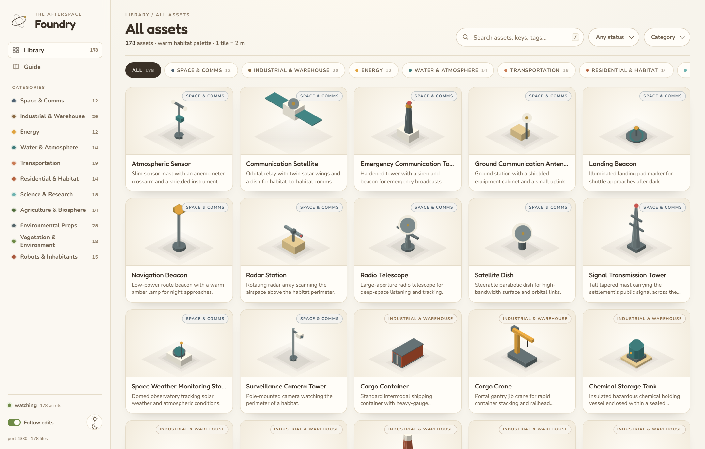
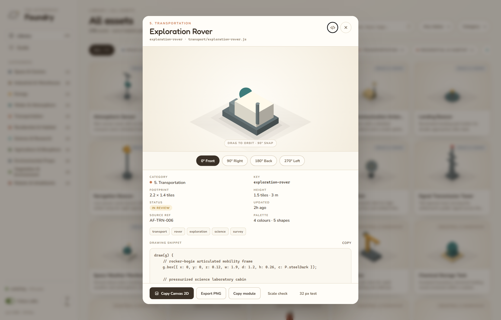
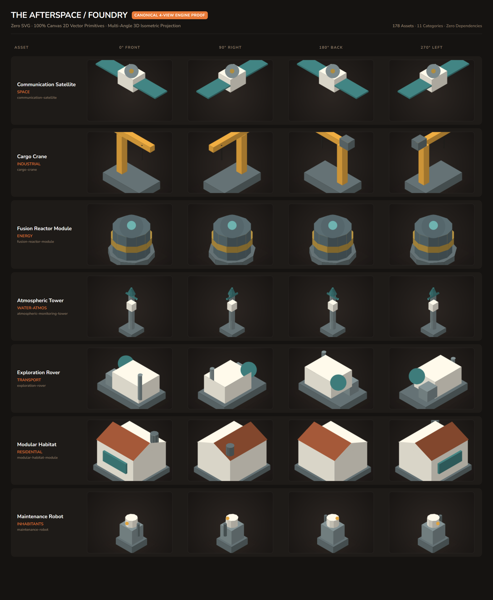
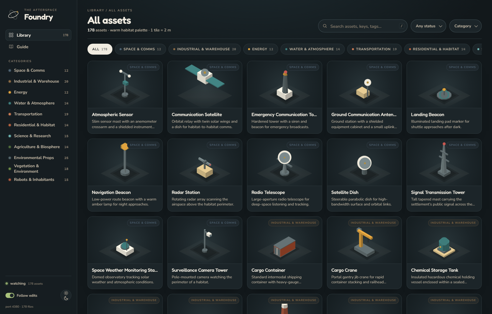

# The Afterspace / Foundry

A local, zero-dependency asset library for **The Afterspace**. Every asset is
drawn entirely in code using pure Canvas 2D isometric primitives, hot-reloads into the
browser as it is saved, and exports to pure CSS and DOM elements or native Canvas 2D
draw functions from the same geometry used in the live preview.



## Quick start

Double-click **`start.cmd`**, or run:

```powershell
node tools\foundry\server.mjs --open
```

The library opens at **<http://127.0.0.1:4321/>**. Press `Ctrl+C` in the
terminal to stop it. If port 4321 is busy, the server automatically finds the next
free port and prints the URL.

No `npm install`, no build step, no CDN. The only runtime is Node's standard
library and the browser.

---

## What is in the library

**178 production assets** across **11 core infrastructure categories** (all passing validation with 0 errors and 0 warnings):

| Category | Assets | Count | Key Assets |
| :--- | :--- | :---: | :--- |
| **01. Space Infrastructure & Communication** | `AF-SPACE-001` .. `012` | **12** | Communication Satellite, Radio Telescope, Launch Pad, Orbital Laser Relay |
| **02. Industrial & Warehouse** | `AF-IND-001` .. `020` | **20** | Cargo Crane, Automated Conveyor, Heavy Storage Rack, Smelting Furnace |
| **03. Energy Infrastructure** | `AF-ENG-001` .. `012` | **12** | Fusion Reactor, Solar Panel Array, Wind Turbine, Battery Storage Unit |
| **04. Water & Atmospheric** | `AF-WAT-001` .. `014` | **14** | Atmospheric Monitoring Tower, Water Purification, Oxygen Generator, CO2 Scrubber |
| **05. Transportation** | `AF-TRN-001` .. `019` | **19** | Maglev Train, Cargo Rover, Passenger Shuttle, Exploration Rover, Landing Pad |
| **06. Residential & Habitat** | `AF-RES-001` .. `014` | **14** | Modular Habitat, Dome Habitat, Entrance Airlock, Balcony Module, Residential Capsule |
| **07. Science & Research** | `AF-SCI-001` .. `015` | **15** | Laboratory Equipment Table, Geological Scanner, Cryogenic Storage, Microscope |
| **08. Agriculture & Biosphere** | `AF-AGR-001` .. `014` | **14** | Hydroponic Growing Rack, Greenhouse Module, Algae Tank, Agricultural Robot |
| **09. Small Environmental Props** | `AF-PRP-001` .. `025` | **25** | Streetlight, Security Barrier, Information Kiosk, Cargo Boxes, Safety Bollards |
| **10. Vegetation & Environment** | `AF-VEG-001` .. `018` | **18** | Bioluminescent Tree, Mutated Tree A/B, Giant Mushroom, Crystal Rock, Alien Fern |
| **11. Robots & Inhabitants** | `AF-INH-001` .. `015` | **15** | Maintenance Robot, Cargo Robot, Scientist, Engineer, Security Personnel, Civilian |
| **Total** | | **178** | **Zero SVG · Pure Canvas 2D Isometric Engine** |

---

## Reviewing an asset

Click any card in the gallery to open the live interactive 3D inspector:

- **0° Front / 90° Right / 180° Back / 270° Left** canonical view snapping.
- **Turntable orbit**: Drag the stage to freely rotate in 3D; release to snap to the nearest 90°.
- **Scale check**: Overlays a 1-tile grid (2 m) and a 1.8 m citizen silhouette for proportion verification.
- **Squint test (32 px)**: Renders the asset at thumbnail resolution to ensure silhouette readability.
- **Multi-format export**: One-click **Copy Canvas 2D Code**, **Copy CSS/DOM**, and **Copy ES Module**.



---

## Canonical multi-angle projections

Every asset adheres to the true isometric projection standards (`30° / 60°` axonometric) and is validated across all four 90-degree canonical turns.



---

## Day & Night theme support

Full support for dark / night operations with high-contrast emissive highlights on solar arrays, bioluminescent foliage, reactors, and warning signals:



---

## The live authoring loop

1. Create or edit an asset file in `assets/<category>/`.
2. Save it.
3. The server detects the change via file system watcher, rebuilds the registry, and pushes an SSE event.
4. The browser hot-reloads the updated cards instantly while preserving inspector state.

```powershell
# Validate every asset and budget constraints
node tools\foundry\validate.mjs

# Scaffold a new asset module
node tools\foundry\new-asset.mjs transport "Cargo Shuttle"
```

An asset is a default-exported JavaScript module with metadata and a `draw(g)` function:

```js
import { P } from '../lib/palette.js';

export default {
  key: 'market-stool',
  name: 'Market Stool',
  category: 'environmental',
  blurb: 'Low wooden stool used at the market stalls.',
  what: 'a low wooden stool',
  footprint: [0.6, 0.6],
  height: 0.5,
  tags: ['market', 'timber', 'seat'],
  refs: ['AF-REF-021'],
  hero: 0,
  status: 'review',
  draw(g) {
    g.box({ x: 0, y: 0, z: 0.34, w: 0.46, d: 0.46, h: 0.08, c: P.timber });
    g.box({ x: 0, y: 0, z: 0, w: 0.36, d: 0.36, h: 0.34, c: P.bark });
  },
};
```

---

## Project structure

```
assets/                         Asset source files (178 modules)
  space/                        Space infrastructure & communication (12)
  industrial/                   Industrial and warehouse props (20)
  energy/                       Energy infrastructure (12)
  water-atmos/                  Water and atmospheric infrastructure (14)
  transport/                    Transportation rovers, shuttles, trains (19)
  residential/                  Residential and habitat modules (14)
  science/                      Science and research equipment (15)
  agriculture/                  Agriculture and biosphere tanks (14)
  environmental/                Small environmental props (25)
  vegetation/                   Vegetation, crystal rocks, mushrooms (18)
  inhabitants/                  Robots, personnel, and civilians (15)
  lib/
    palette.js                  Colour tokens, category metadata & order
    sketch.js                   Pure isometric geometry projection engine
    canvas.js                   Canvas 2D renderer and painter generator
    css.js                      Pure CSS and DOM export
    parts.js                    Shared wheel, panel, solar, and glow helpers
tools/
  foundry/
    server.mjs                  Zero-dependency HTTP server, SSE watcher, API
    library.mjs                 Asset registry scanner, loader, validator
    validate.mjs                CLI validator (budget, schema, naming)
    new-asset.mjs               Asset generator scaffolding
  web/
    index.html                  Foundry application shell
    css/                        Design tokens and responsive layout
    js/                         App shell, scene painter, hover, inspector
    fonts/                      Local Fredoka + Nunito WOFF2 fonts (no CDN)
  qa/                           Automated headless Chrome screenshot and QA scripts
docs/                           Art direction, documentation, screenshots
start.cmd                       Double-click Windows launcher
```

---

## Design & performance constraints

- **Zero SVG**: 100% Canvas 2D vector primitives (`box`, `roof`, `cyl`, `circle`, `decal`).
- **Strict Color Budget**: Maximum 4 palette tokens per asset from `assets/lib/palette.js`.
- **Strict Draw Call Budget**: 3 to 6 primitive calls per asset for optimal rendering performance.
- **32 px Squint Test**: Immediate visual readability at small radar / minimap sizes.
- **Consistent Projection**: True isometric $2:1$ screen projection ($x = (x-y) \cdot \frac{\sqrt{3}}{2}$, $y = (x+y) \cdot 0.5 - z$).
- **No External Dependencies**: Standard Node.js library and modern browser Canvas 2D only.
